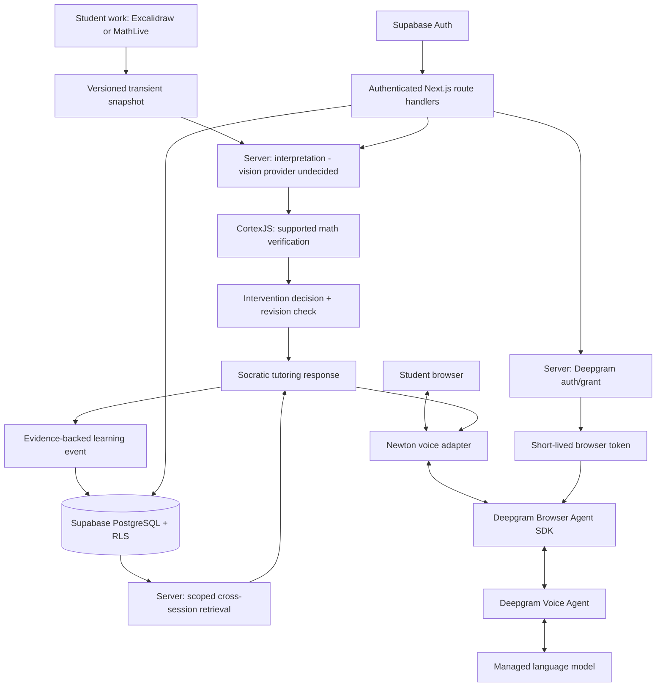

# Newton architecture

## Status and boundaries

This is a proposed MVP design. The homepage, local `/study` workspace (B1), shared TypeScript contracts, developer tooling, Supabase client helpers, and Google OAuth code are implemented; hosted Google configuration/manual acceptance remain pending. `/auth/sign-in` calls `/auth/session` for Google OAuth start, verified current identity, and local sign-out. `/auth/callback` exchanges the PKCE code using a fixed `NEWTON_SITE_URL` redirect. Auth checks and cookie refresh occur in writable Route Handlers; authenticated Server Component rendering and its refresh proxy are not implemented. C1's server-only helpers, session/event persistence, bounded context retrieval, migrations, and local PostgreSQL policy tests are implemented. Both migrations are applied to hosted `newton-dev`; SQL-role, anonymous API, and real signed-in two-account HTTP/helper/direct-client acceptance passed on 2026-11-14. Tutoring/workspace integration remains incomplete. Keep one Next.js application; add dependencies only with the feature that uses them.

The [workstream guide](workstreams/README.md) defines the implementation assignments, concrete boundary proposals, and initial timing/deduplication decisions. Its A01/B01/C01 specifications are the starting points for feature work; additional interface names there are proposals unless explicitly implemented below. `AuthContext` and `StudySession` are local module exports pending the coordinated shared-contract PR.

Voice conversation and mathematical analysis are separate responsibilities. Voice transport does not establish mathematical correctness. A suggested action does not authorize an immediate spoken interruption or a database write.

## Frontend

App Router pages and layout remain Server Components by default. Developer B adds client components at browser-dependent boundaries: Excalidraw, MathLive, audio controls, and workspace state. Load drawing/math libraries on the client as their SSR support requires. Keep loading, empty, permission-denied, retry, and disconnected states visible.

Excalidraw owns freehand work; MathLive provides structured input when recognition is unreliable. Capture only the work region after a pause or explicit request, not continuous screenshots. Each edit, undo, and structured-input change gets a new `revisionId`; snapshot export must preserve the revision of the content actually exported. Reject an export if editing continued during capture. `capturedAt` is informational, not a distributed ordering mechanism.

Images are transient data URLs or short-lived references. Do not put them in learning events, analytics, logs, or durable storage by default. Future handlers enforce content type, payload size, and allowed reference origins; never fetch arbitrary client URLs. Empty snapshots should be rejected before analysis.

### Implemented local workspace (B1)

`/study` mounts `StudentWorkspace`, with a client-only Excalidraw boundary and a dynamically imported MathLive field. B owns one `WorkRevision` clock. Excalidraw's live element IDs, versions, and version nonces identify content changes; selection and viewport state are excluded. Structured edits share the same clock. An export clones the scene and files before asynchronous PNG generation, checks the clock after image encoding, and checks the revision before publishing. Clear, source changes, replacement captures, and unmount invalidate pending work. Clear does not erase persistent history.

Capture exports exactly one selected representation. PNGs cover drawing bounds with padding, exclude exercise/tutor UI, are bounded to 2048 pixels and 2 MiB, and do not embed the editable scene. Structured expressions are trimmed and limited to 500 characters. The supported notation fixture is `2(x+3)=14` from MathLive ASCIIMath, transported as `2*(x+3)=14`. The normalizer accepts only the initial Algebra I notation and rejects unsupported/incomplete syntax without asserting correctness. A must review these fixtures against its parser before B2.

Snapshots remain transient until the student explicitly downloads JSON or PNG. Object URLs are revoked on replacement, edits, source changes, clear, and unmount. No upload, autosave, service call, microphone, synthetic session, or fabricated history is included. Newton stays behind a small side launcher and exposes unavailable voice/help controls on demand until A/C interfaces are merged. No persistent history panel is shown in the workspace. Local fonts are copied from installed packages by `scripts/prepare-workspace-assets.mjs` before development/build, with generated assets ignored by Git.

Run `npm run test:e2e` after `npx playwright install chromium` for the credential-free browser checks at desktop and 360px widths. Unit tests cover revision invalidation, concurrent capture, payload limits, notation normalization, and download cleanup.

### Worksheet reference and workspace layout

The study page fills the viewport. Desktop uses a keyboard/pointer-resizable split between the worksheet reference and whiteboard; mobile switches panes without destroying their contents. The tutor opens from a compact side launcher with Escape/close focus restoration. Audio activation is pending A's real voice integration and microphone opt-in.

`WorksheetPane` accepts one local PDF, PNG, JPEG, or WebP at a time through a file picker, file drop, or screenshot paste. Text paste inside drawing/math editors stays with those editors. Browser files are limited to 20 MiB and validated by signature; image decoding rejects damaged files and images above 32 megapixels. Blob URLs are revoked on replacement, removal, and unmount. A failed replacement preserves the previous worksheet. Request generations discard late file reads. Removing/replacing the reference invalidates pending work captures without clearing the board.

PDF.js is loaded only for PDFs and renders individual pages locally with cancellable render tasks, page navigation, zoom, and an extracted-text reading option. Its worker, fonts, CMaps, and WASM are served locally from generated package assets. There is no remote URL import, document scripting, automatic upload, or persistence. The sample equation and worksheet/whiteboard title bars have been removed to prioritize working space.

Worksheet files are reference material, separate from `WorkSnapshot`, which continues to capture only the student's selected work source. Before B2, A/B must agree how an explicitly requested hint receives worksheet/problem context; no new transport contract or automatic worksheet sharing is implemented here. The user-requested interaction supersedes B1's original permanent tutor/history sidebar layout while preserving capture behavior.

## Server and AI boundaries

Developer A owns proposed `/api/realtime/token` and `/api/work/analyze` route handlers in `src/app/api/`, plus `src/lib/ai/` and `src/lib/math/`. Developer C owns auth, `/api/study-sessions`, and `/api/learning-context`. The workstream guide specifies request/response and error proposals for the first coordinated contract PR; `POST /api/study-sessions` is implemented on this branch; the remaining proposed endpoints are outside this local slice. Event writes initially use C's server-only function called by A, not a public event-write route.

Protected handlers verify the Supabase session, validate request bodies at runtime, check session ownership, and return bounded errors. TypeScript types are not runtime validation. Keep permanent provider credentials server-side, limit request frequency and payload size, and avoid logging student content. Configure clients lazily within the integration so the homepage and CI do not require secrets.

### Managed voice (Developer A)

The selected path is **Student browser → Newton voice adapter → Deepgram Browser Agent SDK → Deepgram Voice Agent → managed language model**. Deepgram supplies streaming speech input, voice-agent orchestration, conversational turns, speech synthesis, and interruption handling. A owns the SDK connection, microphone capture, playback, and event wiring behind the adapter; B consumes its methods and state. Prefer official core `@deepgram/agents` or React hooks according to the reusable boundary; the core SDK uses WebSockets. Follow the current [Browser Agent overview](https://developers.deepgram.com/docs/browser-agent-overview) and [JavaScript SDK guide](https://developers.deepgram.com/docs/browser-agent-javascript), not OpenAI-specific session methods.

We intend to fund voice with Deepgram trial credits because the available ChatGPT/Codex credits do not include OpenAI API access. Start with Deepgram-managed `open_ai` / `gpt-4o-mini`, currently listed in the Standard tier, subject to current availability, pricing, and account credits. Omit a custom `think.endpoint`; this is managed inference with no bring-your-own OpenAI endpoint or `OPENAI_API_KEY`. See [Deepgram's managed LLM models](https://developers.deepgram.com/docs/voice-agent-llm-models). This choice does not automatically qualify Newton for the OpenAI hackathon track; eligibility awaits the organizers.

A keeps the existing `/api/realtime/token` route name; its implementation is Deepgram-specific, not an OpenAI Realtime endpoint. The server uses `DEEPGRAM_API_KEY` with **Member-level permissions or higher** to call `POST https://api.deepgram.com/v1/auth/grant`. Return only the temporary token and normalized expiry with `Cache-Control: no-store`; never return the permanent key. Deepgram documents a default 30-second token TTL and bearer authentication for the browser. The token must be valid when connecting; expiry does not terminate an established connection or cap its cost. See [token-based authentication](https://developers.deepgram.com/guides/fundamentals/token-based-authentication).

C supplies reusable authenticated-user and owned-session checks; A calls them before issuance. Require same-origin requests, rate limits, and deployment-wide abuse protection before enabling billable deployed issuance. Until then, production and preview routes fail closed without provider calls, including for unauthenticated requests. Only a loopback, development-only harness may issue credentials before C's integration; it must be inaccessible in production/preview. See [A1 and the existing implementation audit](workstreams/A01-ai-tutoring.md#existing-implementation-and-migration-follow-up). C must not create a second token endpoint.

Start only following explicit student input and microphone permission. Represent connecting, listening, speaking, interrupted, stopped, and failed states through the adapter. On stop, navigation, failure, or retry, release media tracks, playback/audio contexts, SDK connections, timers, and listeners. Wire user-speech interruption to immediate playback cancellation; allow the conversation to continue and prevent multiple concurrent sessions. Do not persist raw audio or full transcripts by default. A's later intervention controller passes verified analysis into the adapter only after checking the current revision; C's bounded evidence context can seed future tutoring sessions as quoted facts, never trusted instructions. These are separate integrations, not vision or persistent memory provided by the voice agent.

### Interpretation and verification (Developer A)

Interpret the current work separately using a vision-capable model. **The handwritten-work analysis provider remains undecided because we have no funded OpenAI vision API access.** Deepgram Voice Agent is the voice pipeline, not a whiteboard vision service. A must select and fund a separate analysis provider before handwriting integration; structured-input parsing and independent verification can proceed without one. Keep recognized expression, confidence, and source revision together. Structured input can remove handwriting ambiguity but does not prove correctness. CortexJS checks only supported transformations; an equivalent expression alone does not establish that a particular misconception occurred. Recognition ambiguity, parse failures, unsupported transformations, and conflicting evidence produce `correctness: "uncertain"`, not an incorrect label.

### Intervention controller (Developer A, integrated with B)

Use a small controller, not an orchestration framework. Analyze after a configurable pause or explicit help request. Gate proactive speech on mode, current revision, confidence, student activity, voice state, and cooldown. Student-requested mode does not initiate unsolicited hints. If a new edit arrives, cancel pending work where possible and discard late UI/speech results even if cancellation fails. Recheck freshness before displaying or speaking a response. A verified submitted step may persist as historical practice under its original revision even if a later edit races with server completion; never imply it describes the latest work or establishes a correction. The workstream guide supplies tunable initial pause/cooldown values and duplicate-hint rules.

## Shared contracts

`src/types/tutoring.ts` is coordinated by all three developers:

- `WorkSnapshot`: revision, capture time, optional structured expression and transient image. The caller supplies at least one content representation; future runtime validation enforces that rule.
- `WorkAnalysis`: same source revision, recognized expression, concept, correctness, confidence, and suggested action. Its uncertain variant cannot confirm a misconception or request a corrective hint.
- `TutorMode`: `student-requested` or `proactive`.
- `LearningEventInput`: session, source revision, concept, optional misconception, contextual outcome, and short evidence. No client-controlled ownership field.

Initial shared vocabulary: concept `algebra.distributive-property`; misconception `distribution.missed-term`. The workstream specifications use these identifiers consistently. Keep IDs stable across all workstreams. Types are deliberately small; add fields when an integration needs them, with review from affected owners.

`LearningEventRecord` is currently a local export from `src/lib/learning/events.ts`
matching `LearningEventInput & { id: string; createdAt: string }`, pending the
coordinated shared contract PR.

## Authentication and persistent memory (Developer C)

Supabase Auth owns identity. `requireUser()` creates a fresh cookie-aware client and verifies identity with `auth.getUser()` on each request. `requireOwnedSession(auth, sessionId)` queries under that client and filters by both ID and verified owner, returning the same 404 for missing and foreign sessions. `createStudySession(auth)` generates a server UUID and lets database defaults assign ownership/time. All three helpers are server-only; callers must carry `auth.headers` into success and error responses. There is no service-role bypass. A publishable key is public project configuration, not authorization. Do not use privileged credentials to bypass student policies.

Tables defined by migrations in `supabase/migrations/` (applied to hosted `newton-dev` on 2026-11-14):

| Table | Proposed fields | Responsibility |
| --- | --- | --- |
| `student_profiles` | `user_id`, optional `display_name`, `preferred_tutor_mode`, `created_at` | Minimal preferences keyed to Auth identity |
| `study_sessions` | `id`, `user_id`, `started_at`, nullable `ended_at` | Authenticated study context |
| `learning_events` | `id`, `user_id`, `session_id`, `source_revision_id`, `concept`, nullable `misconception`, `outcome`, `evidence`, `created_at` | Factual observations across sessions |

Server assigns owner and timestamps, checks the referenced session belongs to that owner, and accepts only validated observations. RLS must protect reads, inserts, updates, and deletes for student-owned data, including ownership checks on new rows. Foreign-key/ownership constraints must prevent linking an event to another student's session. Developer C owns migrations, indexes, retry deduplication, and tests using two accounts plus an anonymous caller. The workstream guide defines uniqueness by owner/session/revision/concept/outcome with identical retries returning the original record and conflicting payloads rejected; a revision may legitimately support more than one outcome. Events are append-only in normal student access.

Retrieve a bounded, recent set of events scoped to the authenticated user and relevant concept across sessions. Start with ordinary PostgreSQL queries; no vector store. Retain source session and evidence in retrieved context, distinguish correction with help from independent correction, and never infer lasting ability or mastery from one observation. Uncertain perception should not be saved as a confirmed misconception. Client evidence is untrusted: the server write path must validate it against session analysis rather than blindly trusting a posted claim.

For the first integration, A produces eligible observations inside the server analysis path and calls C's writer; no client event-write route is exposed. User-scoped RLS prevents cross-account access but does not prove that a self-owned row inserted directly through Supabase came from the tutor. Treat all retrieved memory as advisory data. The C01 specification explicitly separates account-isolation testing from tamper-resistant provenance, which remains a requirement to resolve before real-student use.

C's `recordLearningEvent(auth, input)` is implemented and locally tested. It
rejects unknown fields, invalid UUIDs/vocabulary, and empty or over-500-character
trimmed evidence. UUIDs are canonicalized and evidence length counts Unicode
characters consistently with PostgreSQL. Only `practiced` and
`misconception-observed` are enabled; the latter requires the supported
misconception. Correction outcomes wait for A's trustworthy prior/hint evidence.
The writer checks ownership before inserting, relies on database defaults for
owner/ID/time, and handles unique conflicts by reading the full owner-scoped
identity and comparing immutable evidence/misconception. It never upserts or
updates a saved event. Identical retries return the original record; changed
payloads return 409. A must still establish observation eligibility before
calling this helper. Real signed-in hosted C1 acceptance passed; see
[the verification record](backend-testing.md#real-two-account-acceptance--2026-11-14).

`getLearningContext(auth, conceptId)` and `GET /api/learning-context` are now
implemented independently of A/B. The query explicitly filters by verified
owner and supported concept across sessions, orders by `created_at DESC, id
DESC`, and returns at most ten rows. The shared stored-record decoder reads all
four database outcomes while correction creation stays disabled in the writer.
No owner fields reach the response. Empty history returns `events: []` and
`summary: ""`; service failures remain distinct. The summary includes UTC dates,
outcomes and JSON-quoted evidence excerpts, capped at 2,000 UTF-16 units without
splitting Unicode characters or modifying the full source records. It makes no
mastery inference. Evidence remains advisory data; future consumers must escape
it and delimit it separately from instructions. `LearningContext` stays a local
export pending the coordinated shared contract.

Do not persist raw audio, screenshots, full conversations, or unnecessary personal information by default. Agree on retention, deletion, and student-facing memory controls before collecting real student data.

## Environment, deployment, and references

`.env.example` names `DEEPGRAM_API_KEY` (server only, Member-level or higher for token grants), optional `OPENAI_API_KEY` (server only, separately funded future vision if selected), `NEXT_PUBLIC_SUPABASE_URL`, and `NEXT_PUBLIC_SUPABASE_PUBLISHABLE_KEY` (public). OpenAI credentials are not required for managed voice. No privileged Supabase key is needed in this scaffold. Next.js bundles `NEXT_PUBLIC_` settings for the browser; never put permanent provider keys or other secrets there.

Target Vercel with Node.js 22 and the npm lockfile. CI runs lint, route type generation/TypeScript, Vitest, and the production build with no credentials. Fonts are system fonts, so builds do not fetch font assets. Developer C will configure Vercel environments, Supabase auth redirect URLs, and RLS before integration deployment. Keep preview and production configuration separate; no hosting resource is created by this scaffold.

Official references checked during initialization (2026-11-13):

- [Deepgram Browser Agent overview](https://developers.deepgram.com/docs/browser-agent-overview) and [core JavaScript SDK](https://developers.deepgram.com/docs/browser-agent-javascript): supported connection and audio lifecycle.
- [Deepgram token-based authentication](https://developers.deepgram.com/guides/fundamentals/token-based-authentication): server key permissions and temporary browser credentials.
- [Deepgram managed LLM models](https://developers.deepgram.com/docs/voice-agent-llm-models): managed model availability and tier; recheck pricing before live use.
- [Supabase Next.js Auth](https://supabase.com/docs/guides/auth/quickstarts/nextjs) and [API keys](https://supabase.com/docs/guides/getting-started/api-keys): public configuration and identity.
- [Next.js installation](https://nextjs.org/docs/app/getting-started/installation), [Vitest setup](https://nextjs.org/docs/app/guides/testing/vitest), and [Tailwind Next.js setup](https://tailwindcss.com/docs/installation/framework-guides/nextjs): application tooling.

Recheck current official SDK docs when implementing integrations; `gpt-4o-mini` is the initial candidate, not a permanent model or session-payload contract. Next.js/React, Excalidraw/MathLive, CortexJS, Supabase Auth/PostgreSQL, learning-event persistence, and developer ownership remain unchanged by this pivot.

### Paper appearance

Paper Light and graphite Paper Dark share semantic CSS colors across the homepage, workspace, worksheet viewer, tutor controls, and math/drawing tools. Appearance offers Light (default), Dark, and System, plus a screen-only comfort preview for worksheet pixels in dark mode. Excalidraw uses its native theme with Paper toolbar tokens; theme changes do not alter scene elements, revisions, or the white-background capture representation.

Only the appearance preference is stored locally (`newton-appearance`); worksheets and student work remain transient. A bootstrap script applies the stored theme before hydration, and a subscribed store follows OS changes in System mode and cross-tab preference changes. Blocked storage falls back to a tab-local preference. PDF/image comfort filtering is presentation-only and never changes original files, mathematical content, or exports.

### Compact drawing and focus mode

The default board shows selection, pen, and eraser tools, native undo/redo, and a small zoom control. Pen settings open a compact color/width popover for subsequent strokes. More tools reveals the native advanced tools and editing controls. Focus mode hides the reference and secondary controls without unmounting either pane, preserving work and revision identity. Exit focus or Escape restores the split view. Worksheet replacement controls appear only when a file is loaded; redundant pane labels and the header's local-workspace status are removed.
