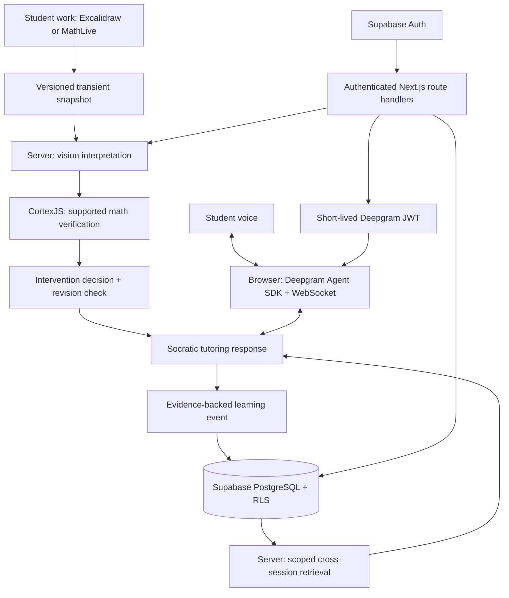

# Newton architecture

## Status and boundaries

This is a proposed MVP design. The homepage, shared TypeScript contracts, developer tooling, and A1 Deepgram voice adapter/local harness exist. Live microphone acceptance remains unverified; analysis and memory are planned. The credential route is local-development-only; no database migrations exist. Keep one Next.js application; add dependencies only with the feature that uses them.

Voice conversation and mathematical analysis are separate responsibilities. Voice transport does not establish mathematical correctness. A suggested action does not authorize an immediate spoken interruption or a database write.

## Frontend

App Router pages and layout remain Server Components by default. Developer B adds client components at browser-dependent boundaries: Excalidraw, MathLive, audio controls, and workspace state. Load drawing/math libraries on the client as their SSR support requires. Keep loading, empty, permission-denied, retry, and disconnected states visible.

Excalidraw owns freehand work; MathLive provides structured input when recognition is unreliable. Capture only the work region after a pause or explicit request, not continuous screenshots. Each edit, undo, and structured-input change gets a new `revisionId`; snapshot export must preserve the revision of the content actually exported. Reject an export if editing continued during capture. `capturedAt` is informational, not a distributed ordering mechanism.

Images are transient data URLs or short-lived references. Do not put them in learning events, analytics, logs, or durable storage by default. Future handlers enforce content type, payload size, and allowed reference origins; never fetch arbitrary client URLs. Empty snapshots should be rejected before analysis.

## Server and AI boundaries

Developer A owns the voice credential handler and proposed work-analysis route handlers in `src/app/api/`, plus `src/lib/ai/` and `src/lib/math/`. Developer C owns auth and memory handlers. Exact URLs and error payloads must be agreed before connecting features; no placeholder endpoints are implemented.

Protected handlers verify the Supabase session, validate request bodies at runtime, check session ownership, and return bounded errors. TypeScript types are not runtime validation. Keep permanent provider credentials server-side, limit request frequency and payload size, and avoid logging student content. Configure clients lazily within the integration so the homepage and CI do not require secrets.

### Realtime voice (Developer A)

Use Deepgram Voice Agent through the official `@deepgram/agents` Browser Agent SDK. A1 uses managed `open_ai` / `gpt-4o-mini` in the Standard tier, Nova-3 STT, and Aura-2 Thalia speech. No BYO endpoint or `OPENAI_API_KEY` is configured for voice. This approved provider change addresses unavailable OpenAI credits while preserving the tutoring design and team ownership.

A owns `POST /api/realtime/token`; its retained path is provider-neutral despite the historical name. `DEEPGRAM_API_KEY` stays server-side and grants a 30-second JWT through `https://api.deepgram.com/v1/auth/grant`. Until C integrates verified identity/session ownership and deployment-wide abuse controls, only the loopback harness can mint tokens: a random per-run capability, exact same-origin POST, bounded payload, and a local five-attempt/ten-minute limit are required. Production/previews/CI and ordinary dev servers fail closed before provider calls. All credential responses use `no-store`.

Start follows explicit student input and microphone permission. The SDK manages WebSocket protocol, PCM input/output, and server turn-taking. The wrapper waits for settings acknowledgement, stops playback on natural speech, and disposes microphone/player/session resources on stop, failure, or unmount, including late microphone permission results. Auto-reconnect is disabled. Manual diagnostics silence/drop the current playback turn; they do not claim to cancel remote generation. The app does not persist audio/transcripts; provider-side retention is governed by Deepgram settings/policies.

The A-owned voice adapter preserves `start`, `stop`, `interrupt`, state snapshots, and subscriptions for B. Later verified `WorkAnalysis` will reach the voice adapter through a reviewed delivery/context interface after session/revision checks. C's bounded learning evidence will be supplied as contextual data alongside the base Socratic prompt via a prompt update/context mechanism. Neither context path is implemented in A1, and voice does not establish mathematical truth. See [A01 specification](workstreams/A01-ai-tutoring.md) and [setup/handoff](ai-voice.md).

Managed OpenAI models through Deepgram do not automatically establish OpenAI Challenge or other hackathon-track eligibility. The team must confirm organizer rules separately.

### Interpretation and verification (Developer A)

Interpret the current work separately using a vision-capable model. Keep recognized expression, confidence, and source revision together. Structured input can remove handwriting ambiguity but does not prove correctness. CortexJS checks only supported transformations; an equivalent expression alone does not establish that a particular misconception occurred. Recognition ambiguity, parse failures, unsupported transformations, and conflicting evidence produce `correctness: "uncertain"`, not an incorrect label.

### Intervention controller (Developer A, integrated with B)

Use a small controller, not an orchestration framework. Analyze after a configurable pause or explicit help request. Gate proactive speech on mode, current revision, confidence, student activity, voice state, and cooldown. Student-requested mode does not initiate unsolicited hints. If a new edit arrives, cancel pending work where possible and discard late results even if cancellation fails. Recheck freshness before displaying or speaking a response and before recording an observation. Pause duration and cooldown are to be tuned during the demo, not fixed architectural promises.

## Shared contracts

`src/types/tutoring.ts` is coordinated by all three developers:

- `WorkSnapshot`: revision, capture time, optional structured expression and transient image. The caller supplies at least one content representation; future runtime validation enforces that rule.
- `WorkAnalysis`: same source revision, recognized expression, concept, correctness, confidence, and suggested action. Its uncertain variant cannot confirm a misconception or request a corrective hint.
- `TutorMode`: `student-requested` or `proactive`.
- `LearningEventInput`: session, source revision, concept, optional misconception, contextual outcome, and short evidence. No client-controlled ownership field.

Initial shared vocabulary: concept `algebra.distributive-property`; proposed misconception `distribution.missed-term`. Agree on identifiers before persisting them. Keep IDs stable across all workstreams. Types are deliberately small; add fields when an integration needs them, with review from affected owners.

## Authentication and persistent memory (Developer C)

Supabase Auth owns identity. Use cookie-aware server clients for Next.js, verify identity server-side, and execute student queries under the user's authenticated context so RLS applies. A publishable key is public project configuration, not authorization. Do not use privileged credentials to bypass student policies.

Planned tables, not implemented migrations:

| Table | Proposed fields | Responsibility |
| --- | --- | --- |
| `student_profiles` | `user_id`, optional `display_name`, `preferred_tutor_mode`, `created_at` | Minimal preferences keyed to Auth identity |
| `study_sessions` | `id`, `user_id`, `started_at`, nullable `ended_at` | Authenticated study context |
| `learning_events` | `id`, `user_id`, `session_id`, `source_revision_id`, `concept`, nullable `misconception`, `outcome`, `evidence`, `created_at` | Factual observations across sessions |

Server assigns owner and timestamps, checks the referenced session belongs to that owner, and accepts only validated observations. RLS must protect reads, inserts, updates, and deletes for student-owned data, including ownership checks on new rows. Foreign-key/ownership constraints must prevent linking an event to another student's session. Developer C owns migrations, indexes, retry deduplication, and tests using two accounts plus an anonymous caller. Agree on event idempotency before enabling automatic retries; a revision may legitimately support more than one outcome.

Retrieve a bounded, recent set of events scoped to the authenticated user and relevant concept across sessions. Start with ordinary PostgreSQL queries; no vector store. Retain source session and evidence in retrieved context, distinguish correction with help from independent correction, and never infer lasting ability or mastery from one observation. Uncertain perception should not be saved as a confirmed misconception. Client evidence is untrusted: the eventual write route must validate it against session analysis rather than blindly trusting a posted claim.

Do not persist raw audio, screenshots, full conversations, or unnecessary personal information by default. Agree on retention, deletion, and student-facing memory controls before collecting real student data.

## Environment, deployment, and references

`.env.example` names `DEEPGRAM_API_KEY` (server only), `NEXT_PUBLIC_SUPABASE_URL`, and `NEXT_PUBLIC_SUPABASE_PUBLISHABLE_KEY` (public). No privileged Supabase key is needed in this scaffold. Next.js bundles `NEXT_PUBLIC_` settings for the browser; never put secrets there.

Target Vercel with Node.js 22 and the npm lockfile. CI runs lint, route type generation/TypeScript, Vitest, and the production build with no credentials. Fonts are system fonts, so builds do not fetch font assets. Developer C will configure Vercel environments, Supabase auth redirect URLs, and RLS before integration deployment. Keep preview and production configuration separate; no hosting resource is created by this scaffold.

Official references checked during initialization (2026-11-13):

- [Deepgram Browser Agent SDK](https://developers.deepgram.com/docs/browser-agent-javascript), [temporary-token auth](https://developers.deepgram.com/guides/fundamentals/token-based-authentication), and [managed LLMs](https://developers.deepgram.com/docs/voice-agent-llm-models): current voice provider. Earlier OpenAI Realtime selection is superseded for A1.
- [Supabase Next.js Auth](https://supabase.com/docs/guides/auth/quickstarts/nextjs) and [API keys](https://supabase.com/docs/guides/getting-started/api-keys): public configuration and identity.
- [Next.js installation](https://nextjs.org/docs/app/getting-started/installation), [Vitest setup](https://nextjs.org/docs/app/guides/testing/vitest), and [Tailwind Next.js setup](https://tailwindcss.com/docs/installation/framework-guides/nextjs): application tooling.

Recheck current official SDK docs when implementing integrations; no provider model IDs or SDK session payloads are frozen here.
